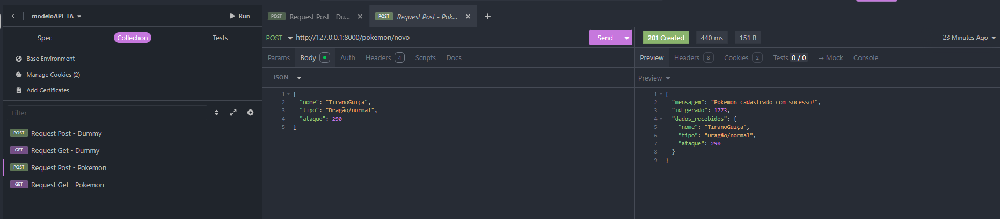

# PBE — Programação Back End (SENAI)

Repositório com as **aulas, atividades formativas e projetos** que desenvolvi na
disciplina de **Programação Back End (PBE)** do curso técnico no SENAI.

A maior parte dos projetos usa **PHP + Laravel**. Tem também um site em
**WordPress** e alguns exercícios de PHP puro. Cada pasta é um projeto
independente: dá para abrir, instalar e rodar cada um separadamente.

---

## 📂 Estrutura de pastas

```
PBE/
├── aulas/                      # Exercícios feitos durante as aulas
│   ├── primeira-formativa/     # 1ª atividade: ex1.php + primeiro projeto Laravel
│   │   └── prints/             # Prints do passo a passo no Laragon
│   └── AULAS1E2/               # Aulas 1 e 2: rotas, prefixos, nomes de rotas e views
│
├── formativas/                 # Atividades formativas (avaliações práticas)
│   ├── FORMATIVA_ROTAS/        # Rotas com parâmetros, any/match, redirect e grupos
│   └── FORMATIVA_WORDPRESS/    # Site em WordPress com tema médico
│
├── projetos/                   # Projetos maiores (sistemas completos)
│   ├── confeccao/              # ERP de confecção v1 (Laravel + Breeze)
│   ├── confeccaoTA2/           # ERP de confecção v2 (Laravel 13 + Filament)
│   ├── modeloAPI_TA/           # Pokédex que consome a PokeAPI
│   ├── PredialFix/             # Telas de login e cadastro
│   └── safe/                   # Sistema de saída/entrada de alunos
│
├── telas-de-login/             # Estudos de autenticação com starter kits
│   ├── telaloginTA/            # Livewire + Flux
│   └── telaloginTA2/           # Inertia + React + TypeScript
│
├── index.php                   # Página inicial padrão do Laragon
├── .gitignore
└── README.md                   # (este arquivo)
```

---

## 🗂️ Os projetos

### Aulas

| Projeto | O que é |
|---|---|
| [`primeira-formativa`](aulas/primeira-formativa) | Primeira atividade: um `ex1.php` simples e o primeiro projeto Laravel criado no Laragon. |
| [`AULAS1E2`](aulas/AULAS1E2) | Exemplos das aulas 1 e 2 sobre rotas: `Route::get`, `any`, `match`, parâmetros, `prefix` e `name`. |

### Formativas

| Projeto | O que é |
|---|---|
| [`FORMATIVA_ROTAS`](formativas/FORMATIVA_ROTAS) | Site com páginas `empresa`, `noticias` e `contato` recebendo parâmetros na URL, rotas públicas/restritas por método HTTP, redirecionamentos e um grupo `admin`. |
| [`FORMATIVA_WORDPRESS`](formativas/FORMATIVA_WORDPRESS) | Site em WordPress com temas médicos (Cardiopress / Medazin). |

### Projetos

| Projeto | O que é | Destaques |
|---|---|---|
| [`confeccao`](projetos/confeccao) | Sistema de gestão para uma confecção (1ª versão). | Login com Breeze, CRUD de clientes, fornecedores, produtos, estoque e pedidos. |
| [`confeccaoTA2`](projetos/confeccaoTA2) | ERP de confecção (2ª versão), com painel administrativo. | Filament 5, controle de acesso por cargos, baixa automática de estoque. Veja a [documentação completa](projetos/confeccaoTA2/docs/DOCUMENTACAO.md). |
| [`modeloAPI_TA`](projetos/modeloAPI_TA) | Pokédex que mistura Pokémon cadastrados no banco com dados da [PokeAPI](https://pokeapi.co). | Consumo de API externa com `Http::get`, busca, cadastro com foto. |
| [`PredialFix`](projetos/PredialFix) | Telas de login e cadastro de um sistema de manutenção predial. | Front-end em Blade. |
| [`safe`](projetos/safe) | Sistema de autorização de **saída antecipada** e **entrada atrasada** de alunos. | Perfis (AQV, portaria, professor), cursos, alunos, notificações. |

### Telas de login

| Projeto | O que é |
|---|---|
| [`telaloginTA`](telas-de-login/telaloginTA) | Starter kit do Laravel com **Livewire + Flux**: login, cadastro, 2FA e configurações de perfil. |
| [`telaloginTA2`](telas-de-login/telaloginTA2) | Starter kit do Laravel com **Inertia + React + TypeScript**: as mesmas telas, em React. |

---

## 📸 Demonstração

Testando a API do `modeloAPI_TA` no **Insomnia** (cadastro de um Pokémon):



Primeiro projeto Laravel rodando no Laragon:


---

## 🛠️ Tecnologias

- **PHP 8.2+** e **[Laravel](https://laravel.com) 12 / 13** (os projetos em Laravel 13 pedem PHP 8.3)
- **Blade**, **Tailwind CSS** e **Vite** no front-end
- **Laravel Breeze**, **Livewire / Flux**, **Inertia + React** (autenticação)
- **[Filament](https://filamentphp.com)** (painel administrativo do `confeccaoTA2`)
- **SQLite** ou **MySQL** como banco de dados
- **WordPress** (formativa)
- **[Laragon](https://laragon.org)** como ambiente local no Windows

---

## 🚀 Como rodar um projeto Laravel

Pré-requisitos: **PHP 8.2+** (8.3 para Laravel 13), **Composer** e **Node.js**. O jeito mais fácil no
Windows é instalar o **Laragon**, que já traz PHP, Composer e MySQL.

Os passos abaixo valem para qualquer projeto Laravel deste repositório.
Exemplo com o `confeccao` (no PowerShell):

```powershell
# 1. Entre na pasta do projeto
cd projetos\confeccao

# 2. Instale as dependências do PHP
composer install

# 3. Crie o arquivo de configuração a partir do exemplo
copy .env.example .env

# 4. Gere a chave da aplicação
php artisan key:generate

# 5. Crie as tabelas do banco (por padrão usa SQLite)
php artisan migrate

# 6. Instale e compile o front-end
npm install
npm run build

# 7. Suba o servidor
php artisan serve
```

Depois abra **http://127.0.0.1:8000** no navegador.

> 💡 **Dica:** se o projeto usar MySQL, crie o banco antes e preencha as
> variáveis `DB_*` no arquivo `.env`.
>
> O `confeccaoTA2` tem um passo a passo próprio no
> [README dele](projetos/confeccaoTA2/README.md) (inclui `php artisan db:seed` e
> o login do administrador).

### Rodando o WordPress

1. Copie a pasta `formativas/FORMATIVA_WORDPRESS` para `C:\laragon\www`.
2. Crie no MySQL um banco chamado `projetoForma`.
3. Confira usuário e senha do banco em `wp-config.php`.
4. Abra o site pelo Laragon e siga o instalador do WordPress.

---

## 👤 Autor

**Daniel Charlo** — estudante do SENAI
GitHub: [@danielcharlodev](https://github.com/danielcharlodev)
